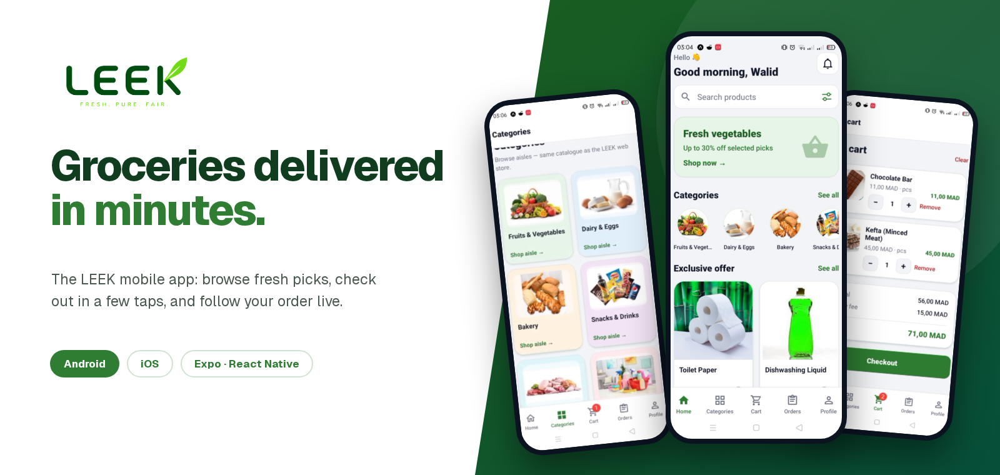

<p align="center">
  
</p>

<h1 align="center">LEEK Mobile</h1>

<p align="center">
  The native Android &amp; iOS app for <strong>LEEK</strong>, a quick-commerce grocery delivery service in Casablanca.<br/>
  Browse the catalogue, fill your cart, check out, and follow your order live.
</p>

<p align="center">
  
  
  
  
  
</p>

---

## Demo

Click the preview to watch the full walkthrough (sign in → browse → product → cart → checkout → order tracking)

<p align="center">
  <a href="./docs/demo.mp4">
    
  </a>
  <br/>
  <sub>▶ <a href="https://drive.google.com/file/d/1upZWWevgoIMuV39iaLo3Io5xJgU4bw-Z/view?usp=sharing"><strong>Watch the full demo (3 min)</strong></a></sub>
</p>

---

## About

**LEEK** delivers fresh groceries in 15–30 minutes at fair prices (*Fresh. Pure. Fair.*). This repo is the **customer mobile app**, built with **Expo** and **React Native**. It shares one Supabase project with the other LEEK apps:

| App | Purpose |
|---|---|
| **leek_mobile** (this repo) | Customers browse, order, and track deliveries on their phone |
| leek_app | Customer web storefront |
| leek_admin | Store team manages catalogue, stock, and order status |
| leek_website | Marketing landing page |

---

## Features

| Area | What it does |
|---|---|
| **Tab navigation** | Home, Categories, Cart, Orders and Profile in a bottom tab bar, with a live cart badge |
| **Catalogue** | Categories with photos, product grids per aisle, search with filters, stock info on every product |
| **Product page** | Photo, rating, price, stock badge, description, quantity stepper, favourite and cart shortcuts |
| **Cart** | Quantity controls, remove / clear, subtotal, **delivery fee** and total |
| **Auth** | Email + password sign in via Supabase, account creation, profile screen with sign out |
| **Checkout** | Choose a saved delivery address or add one, pick **cash on delivery**, **wire transfer** or **card**, add order notes |
| **Safe ordering** | Orders go through a server-side Supabase RPC; errors are translated for the user (`lib/rpcErrors.ts`) |
| **Live tracking** | Orders list with All / Ongoing / Completed / Cancelled filters, pull to refresh, and a status timeline per order |
| **Confirmation** | "Thank you" screen with order ID, total and estimated delivery time |

### Order lifecycle

```
Order placed  →  Picking  →  Out for delivery  →  Delivered
```

---

## Tech stack

- **Expo** + **React Native** with **Expo Router** (file-based navigation)
- **TypeScript**
- **Supabase** for auth, Postgres, RPC and Realtime
- **EAS Build** for Android / iOS binaries
- Gradle-based native Android project (`android/`) for local builds

---

## License

© LEEK. Walid Hattaoui.

